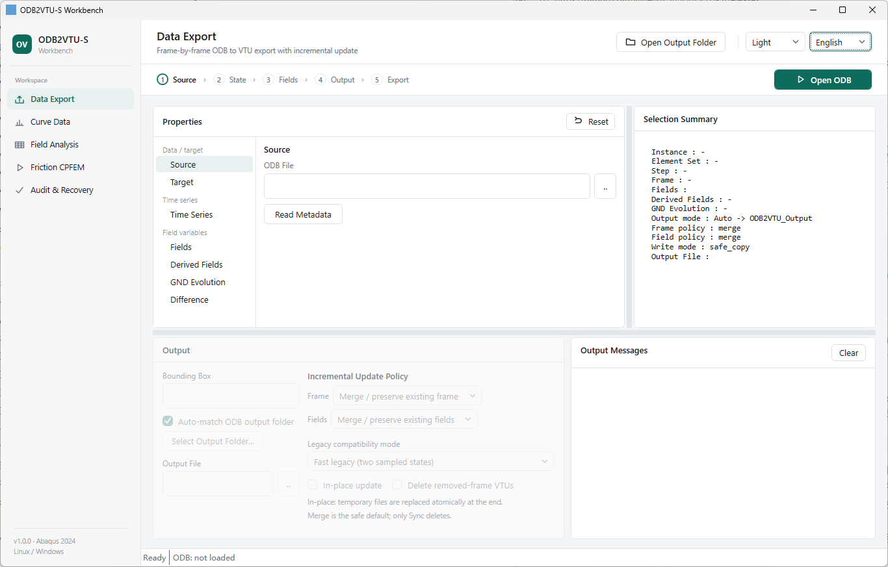

# ODB2VTU-S

**Selective Abaqus ODB → VTU/PVD export and CPFEM post-processing**

[English](README.md) | [简体中文](README.zh-CN.md) · [Releases](https://github.com/yline0829/ODB2VTU-S/releases) · [MIT License](LICENSE)

ODB2VTU-S is a Windows/Linux workbench for extracting selected results from large Abaqus ODB files and preparing ParaView visualizations and CPFEM analyses.

**v1.0.1 UI update:** The Windows Workbench now features a refreshed green-and-neutral theme, left workspace navigation, and reorganized export pages. The Linux Workbench has also been updated with improved navigation and bilingual labels. The ODB/VTU numerical backends are retained. [What changed](docs/RELEASE_NOTES_v1.0.1.md).

## Unified Workbench

The Windows interface follows a five-step workflow:

**1. Data Source → 2. Target States → 3. Field Variables → 4. Output → 5. Export**

The workspace provides a selection summary, output settings, execution logs, light/dark themes, and Chinese/English switching. The left **Workspace** navigation provides **Data Export, Curve Data, Field Analysis, Friction CPFEM, and Audit & Recovery**. The source, state, fields, output and export flow remains within the Data Export page.

## Features

- **Selective export:** choose instances, element/grain sets, Steps, Frames, and fields; write ParaView-compatible VTU/PVD.
- **Incremental updates:** Frame/Field **Merge** preserves existing data by default; **Sync** explicitly aligns output with the current selection.
- **In-place mode:** optionally update existing VTUs in their original directory with validation and rollback protection.
- **Analysis:** GrainID, Mises stress, initial IPF, GND evolution, field differences, and grain ranking.
- **Post-processing:** history curves, friction-related outputs, PEEQCP reconstruction, and diagnostic/recovery tools.

## Download and requirements

**[Download latest release](https://github.com/yline0829/ODB2VTU-S/releases/latest)**

| Platform | Package | Requirements |
| --- | --- | --- |
| Windows | Windows EXE (`odb2vtu.exe`) / latest Release asset | Windows, PowerShell/.NET, licensed Abaqus |
| Linux | Linux ZIP / latest Release asset | Python 3 + Tkinter; designed for CentOS 7, SingularityCE, Abaqus 2024 |

The v1.0.1 Windows executable contains a new UI while preserving the earlier embedded calculation resources; Linux packaging and syntax were checked independently. The new Windows UI has not been independently run against production ODB datasets in this update. Running ODB operations requires your own licensed Abaqus installation with `odbAccess`. Back up important datasets before in-place updates or ODB write-back.

[Windows guide](docs/install-windows.md) · [Linux guide](docs/install-linux.md) · [Incremental export](docs/incremental-export.md) · [PEEQCP](docs/peeqcp.md) · [v1.0.0 provenance](docs/validated-v1.0.0.md)

*Independent project; not affiliated with Dassault Systèmes. No proprietary Abaqus components are distributed.*
