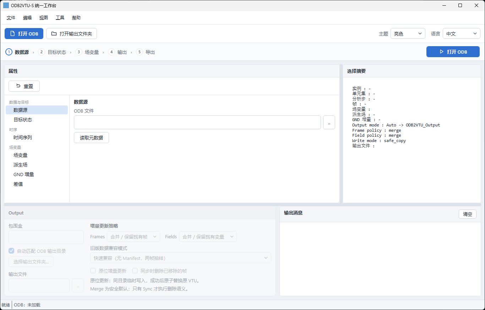

# ODB2VTU-S

### 面向大型 Abaqus ODB 的选择性 ParaView 导出与 CPFEM 后处理工具集

[English](README.md) | **简体中文**

[](https://github.com/yline0829/ODB2VTU-S/releases/latest)
[](LICENSE)


**面向大型 Abaqus ODB 的选择性后处理工具集。** 主要用于 ODB 选择性读取、ParaView 可视化、晶粒尺度场分析、GND 演化、摩擦时历数据提取以及 PEEQCP 重构。

> 本项目与 Dassault Systèmes 无关联。读取和写入 ODB 需要用户本机已安装并获得合法许可的 Abaqus；本仓库不分发 Abaqus 库、可执行文件或其他商业软件组件。

## 下载

普通用户建议直接从 **GitHub Releases** 下载最新打包版本：

**[下载最新版本](https://github.com/yline0829/ODB2VTU-S/releases/latest)**

当前 Release 安装包已统一采用 **ODB2VTU-S** 命名：

- **Windows — ODB2VTU-S Exporter 数据导出器**
- **Windows — ODB2VTU-S CPFEM Postprocessor**
- **Linux — 两个工具的整合版本**

仓库本身用于源码维护。最新开发测试包可从成功运行的 **GitHub Actions → Build packages** 下载，正式发布文件仍通过 **Releases** 提供。

## 项目概览

目前工具集包含两个互补的小程序。**ODB2VTU-S** 中的 **S = Selective（选择性）**，强调针对大型 ODB 只读取和导出真正需要的数据：

| 程序 | 主要用途 |
|---|---|
| **ODB2VTU-S Exporter** | 面向大型 ODB 的选择性 ODB → VTU/PVD 导出、任意 Step/Frame 场变量比较、ParaView 场变量、GrainID、Initial IPF、Mises、GND 差值、晶粒极值分析以及 History/Curve 数据 |
| **ODB2VTU-S CPFEM Postprocessor** | RP 时历数据提取，以及基于物理时间匹配的 PEEQCP 逐帧重构、目标帧保存与写回 |

## 核心特色

### 选择性 ODB → VTU/PVD，而不是整库转换

ODB2VTU-S Exporter 面向大型 Abaqus ODB。用户可以只选择真正需要的 **Instance、晶粒/单元区域、Step、Frame 和 Field Output**，然后仅把这些状态导出成 ParaView 可直接读取的 VTU/PVD。对于几十 GB、上百 GB 的 ODB，不需要为了看少量关键状态而把整个数据库全部转换。

### 任意 Step/Frame 组合成 ParaView 时间序列

时间序列不是固定模板，也不要求连续帧。用户可以自由选择多个 Step，并把任意 Frame 加入导出序列，因此可以直接比较多个摩擦循环中具有相同物理位置或相同阶段意义的状态。

### 任意 SDV / 标量场的跨 Step/Frame 差值比较

对于单元标量场，包括用户自定义的 **SDV 变量**，程序可以在任意两个已存储状态之间计算：

```text
DELTA_Field = Field(目标 Step/Frame) - Field(参考 Step/Frame)
```

参考 Step 和参考 Frame 都可以自由选择。因此可以直接比较例如 `SDV29`、`SDV66`、`SDV104` 或其他标量单元变量在下压、不同摩擦循环或不同时间状态之间的变化，并把差值场直接导入 ParaView 做云图分析。

### 晶粒尺度关联分析

程序可重构 `GrainID`，提供 `<所有晶粒>` 虚拟区域，并把场变量极值与具体晶粒关联起来；支持 Top-N 晶粒和极值区间晶粒筛选，还可以只导出这些目标晶粒，使 ParaView 中完全不显示无关晶粒。

### 在 Abaqus 原生输出基础上生成 CPFEM 派生场

当前已支持的模型相关派生结果包括：**Mises 应力、Initial HCP-Ti IPF、18 个滑移系 GND 演化、滑动起点 GND 增量，以及基于 `Fp = SDV1–SDV9` 重构的 PEEQCP**。

### 面向循环摩擦的物理时刻匹配

PEEQCP 仍遍历全部存储帧进行累积，但只保存具有明确物理意义的状态：
- 下压/法向加载：首帧 + 末帧
- 每个摩擦循环：按 StepTime 取 **T0 / T25 / T50 / T75 / T100**

如果目标 StepTime 没有恰好对应的 ODB 输出帧，程序自动选择时间最接近的真实 Frame。

> 说明：当前通用场变量比较实现的是**已存储帧之间的差值**，不是两个 Frame 之间的连续时间插值。如果后续需要对任意场变量按目标 StepTime 做真正的线性时间插值，可以作为下一阶段功能加入。

## 帧 / 变量两级增量更新

ODB2VTU-S v0.2 将导出逻辑拆分为两个独立层级：

- **帧 Merge（默认）**：本次选择的 Step/Frame 新增或更新，之前已导出的帧继续保留在 PVD 中。
- **帧 Sync**：PVD 的活动帧严格同步为本次 Step/Frame 选择，用于显式删除帧。
- **变量 Merge（默认）**：同一帧中已经存在的变量保留，本次选择的新变量追加到最终字段集合。
- **变量 Sync**：把所选帧重建为本次变量集合，用于显式删除旧变量。

因此默认的 **Merge + Merge** 是非破坏性的：重复导出不会因为本次未再次勾选某个旧帧或旧变量而把它删除。

完整规则见 [增量导出逻辑](docs/incremental-export.md)。

### 性能优化版 v0.2.0：变量级增量导出

当前 **v0.2.0 源码**除了帧级跳过，还支持**真正按变量读取的增量导出**：

- `unchanged`：选中 Step/Frame 的源 ODB 版本和输出配置未变化，**直接跳过，不写回 VTU**。
- `INCREMENTAL`：从已有 ASCII VTU 分块复用未变化的 DataArray；只从 ODB 读取新增 SDV 或需要重新计算的派生场；完成后安全替换 VTU。
- `FULL`：全新帧、无法验证旧 VTU 或发生不兼容变更时，完整导出。该路径同样享有 GND/IPF/参考帧跨帧缓存、GND 源 SDV 复用和批量 ASCII 写入优化。

软件**先扫描目标文件夹**，以 ODB 中的 **Step 名称 + Frame 序号**识别已有 VTU，保留旧文件名。旧文件名开头的六位数字是导出文件的排列编号，不是 ODB 的 Frame 编号；新帧才分配未占用编号。

**已有帧补充 SDV 的推荐操作：** 保持 **Frame Merge + Field Merge**，选择要更新的帧，**只勾选新增 SDV**；之前导出的 SDV、Initial IPF 和 GND 差值，即使本次不勾选也会保留。若重新勾选同一派生场并改变基准或参数，则按新配置更新该派生场。**Field Sync** 则会删除本次未选择的旧字段；**Frame Sync** 则会让 PVD 仅保留本次选择的帧，和变量选项相互独立。

**实测记录（2026-10-15，已有 VTU 追加 SDV）：** 优化前约 **242 秒/帧**，优化后约 **45 秒/帧**，处理速度约 **5.4 倍**，耗时减少约 **81%**。用户已核对导出数据正常。该结果**只针对已有帧增量更新**，不能等同于全新帧首次 `FULL` 导出的速度；后者尚未完成同条件实测。

程序仍会完整写出并安全替换最终 VTU，而不是直接在原 VTU 文件内部修改数组。大型 ODB 的首次导出速度仍受变量数量、数据规模与磁盘性能影响。不要让两个程序同时写入同一 PVD；更新软件前建议备份 PVD、VTU 和 Manifest。

详见 [增量导出实现和限制](docs/incremental-export.md)。

## 软件截图

### 1. ODB2VTU-S Exporter 数据导出器

可选择 ODB、实例、晶粒区域、分析步、帧以及需要导出的场变量。支持多分析步的 ParaView 时间序列导出，不需要把整个大型 ODB 全部转换。

<p align="center">
  
</p>

### 2. ODB2VTU-S CPFEM Postprocessor

用于 RP 时历数据以及 PEEQCP 重构。PEEQCP 仍然遍历全部存储帧进行累积，但只保存选定的物理状态，用于后续对比或写回 ODB。

<p align="center">
  
</p>

### 3. ParaView — 重构 PEEQCP

导出的 PVD/VTU 可以直接在 ParaView 中打开。下面示例显示摩擦/CPFEM 模型中的重构 PEEQCP 场。

<p align="center">
  
</p>

### 4. ParaView — 初始晶体学取向

ODB2VTU-S Exporter 可以根据 INP 中每个晶粒 Material 的 Euler 角重构初始晶粒取向，并输出与 HCP-Ti IPF 相关的 ParaView 场变量。

<p align="center">
  
</p>

## 功能

### ODB2VTU-S Exporter

- ODB → **VTU/PVD** 选择性导出，用于 ParaView
- 面向大型 ODB：只读取选定实例、集合、分析步、帧和场变量
- `GrainID` 重构和 `<所有晶粒>` 虚拟集合
- 计算并导出 **von Mises 应力**
- 根据 INP 中各晶粒 Material 的 Euler 角生成 **Initial HCP-Ti IPF**
- 场变量极值 / 晶粒关联分析
- Top-N 或极值区间晶粒单独导出
- History / Curve 时历 CSV 导出
- 基于 `gnd_field.dat` 与 `SDV11–SDV28` 的 **18 个滑移系 GND 演化**
- 以首次滑动帧或前一分析步末帧为基准的滑动阶段 GND 增量

### ODB2VTU-S CPFEM Postprocessor

- RP 时历提取：`U1/U2`、`RF1/RF2`、`CF1/CF2`、COF
- 根据 `Fp = SDV1–SDV9` 进行逐帧 PEEQCP 重构
- 目标状态保存：
  - 下压 / 法向加载分析步：首帧 + 末帧
  - 每个摩擦循环：按 StepTime 取 **T0/T25/T50/T75/T100**
- 如果目标 StepTime 没有恰好对应输出帧，则自动匹配最接近的真实 ODB Frame
- 可将 PEEQCP 写回这些目标帧
- Linux 版本支持实时进度日志和计算/写回完成提示

## 仓库结构

```text
src/
  data_exporter/
    backend/     # Abaqus-Python ODB 后端
    windows/     # PowerShell/WPF 界面
    linux/       # Python/Tk 界面
  postprocess/
    backend/     # History + PEEQCP 后端
    windows/     # PowerShell 界面
    linux/       # Python/Tk 界面
packaging/linux/ # Linux 桌面安装/卸载脚本
scripts/         # Release 打包脚本
docs/            # 方法和安装说明
examples/        # 小型、非专有示例文件
```

## 运行要求

- 已获得合法许可并安装的 Abaqus，且能够使用 `odbAccess`
- 可执行 Abaqus 命令，例如 `abaqus` 或 `abq2024`
- ParaView，用于 VTU/PVD 可视化
- Windows：Windows PowerShell / WPF
- Linux GUI：Python 3 + Tkinter

如果 Linux 中的 Abaqus 通过 Singularity/Apptainer 容器运行，可以在软件的 **Abaqus command** 中填写完整命令前缀，例如：

```bash
singularity exec /path/to/abaqus2024.sif /opt/run_abaqus.sh
```

软件会自动在后面追加 `python <backend.py> ...`，因此不需要再手动添加 `cae -mesa`。

## 重要模型假设

部分 CPFEM 功能与当前 UMAT 的变量定义直接相关，并不是 Abaqus 通用定义。

当前 GND 映射假设：

- `SDV11–SDV28` 为 18 个滑移系的 GND 密度
- `gnd_field.dat` 第 1 列为 Abaqus element label
- 第 2–10 列为 9 个初始 GND / Burgers 方向密度
- 每个方向平均分配到对应的两个滑移系

使用其他 UMAT 前，请先阅读 [GND 映射说明](docs/gnd_mapping.md) 并确认 SDV 定义一致。

PEEQCP 重构假设 `SDV1–SDV9` 按当前文档中的 Fortran 列主序保存 `Fp`。详细方法见 [PEEQCP 方法说明](docs/peeqcp.md)。

## 安装说明

- [Windows 安装说明](docs/install-windows.md)
- [Linux 安装说明](docs/install-linux.md)

普通用户建议直接下载 **Releases** 中的打包文件。

## 构建 Release 包

在普通 Python 3 环境运行：

```bash
python scripts/build_release.py
```

生成的 ZIP 将写入 `dist/`，该目录不会提交到 Git。

## 开发状态

当前开发源码版本为 **v0.2.0**，重点包含 Frame/Field 两级 Merge/Sync、文件夹 VTU 识别、变量级增量复用以及参考数据跨帧缓存。**GitHub Releases 公开资产可能仍是较早版本**，请以具体 ZIP 文件名和版本号为准。此前 v0.1.2 主要新增独立桌面图标和 Linux 小屏幕交互改善。

如果遇到 Abaqus 版本兼容、特定单元类型、场变量映射或工作流问题，欢迎通过 GitHub **Issues** 提交。

## 许可证

MIT License，详见 [LICENSE](LICENSE)。
