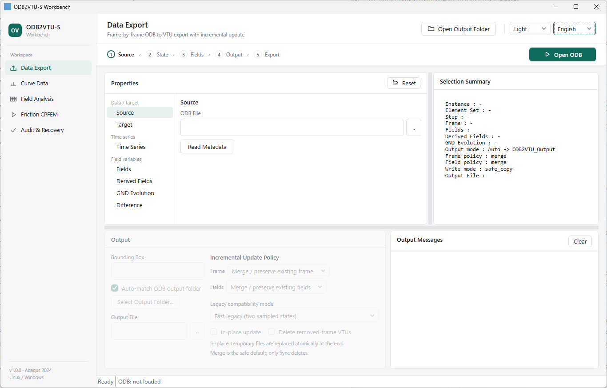

# ODB2VTU-S

**Abaqus ODB 选择性导出至 VTU/PVD · CPFEM 数据后处理工具**

[English](README.md) | [简体中文](README.zh-CN.md) · [下载软件](https://github.com/yline0829/ODB2VTU-S/releases) · [MIT 开源许可](LICENSE)

ODB2VTU-S 是面向 Windows/Linux 的统一工作台，用于从大型 Abaqus ODB 中选择性读取结果，导出 ParaView 可视化数据，并进行晶粒尺度与 CPFEM 后处理。

**v1.0.1 界面更新：** Windows 工作台采用新版绿色主题与左侧功能导航，数据导出页面重新布局；Linux 同步优化导航与中英文界面。原有 ODB/VTU 数值后端保留。[查看更新说明](docs/RELEASE_NOTES_v1.0.1.md)。

## 统一工作台

Windows 版采用清晰的五步操作流程：

**① 数据源 → ② 目标状态 → ③ 场变量 → ④ 输出 → ⑤ 导出**

界面提供**选择摘要、输出设置、运行日志、明暗主题和中英文切换**。左侧 **Workspace** 导航提供 **Data Export（数据导出）、Curve Data（曲线数据）、Field Analysis（场变量分析）、Friction CPFEM（摩擦后处理）、Audit & Recovery（诊断与恢复）**；数据导出页保留数据源、目标状态、场变量、输出和导出五步流程。

## 核心功能

- **选择性导出**：按 Instance、单元/晶粒集合、Step、Frame 和场变量生成 VTU/PVD。
- **增量更新**：Frame/Field **Merge** 默认保留已有数据；**Sync** 用于显式同步当前选择。
- **原位更新**：可选在已有 PVD/VTU 目录更新，采用前置验证与回滚保护。
- **场变量分析**：支持 GrainID、Mises、初始 IPF、GND 增量、变量差值及晶粒排序。
- **后处理工具**：History 曲线、摩擦数据、PEEQCP 重构以及只读诊断和安全恢复。

## 下载与运行环境

**[下载最新正式版](https://github.com/yline0829/ODB2VTU-S/releases/latest)**

| 平台 | 程序包 | 环境 |
| --- | --- | --- |
| Windows | Windows EXE（`odb2vtu.exe`）及最新 Release 附件 | Windows、PowerShell/.NET、Abaqus |
| Linux | Linux ZIP（以最新 Release 附件为准） | Python 3 + Tkinter；适配 CentOS 7、SingularityCE、Abaqus 2024 |

v1.0.1 Windows EXE 包含**新界面**，原有内嵌计算后端保留；Linux 包完成了独立的语法与打包检查。本次尚未在真实大型 ODB 数据上独立复测 Windows 新版界面。读取 ODB 需要用户自行安装并获得合法许可的 Abaqus（含 `odbAccess`）。原位更新或 ODB 写回前建议备份重要数据。

[Windows 使用说明](docs/install-windows.md) · [Linux 安装说明](docs/install-linux.md) · [增量更新说明](docs/incremental-export.md) · [PEEQCP 方法](docs/peeqcp.md) · [v1.0.0 基准说明](docs/validated-v1.0.0.md)

*本项目独立开发，与 Dassault Systèmes 无关联，不分发 Abaqus 专有程序或运行库。*
